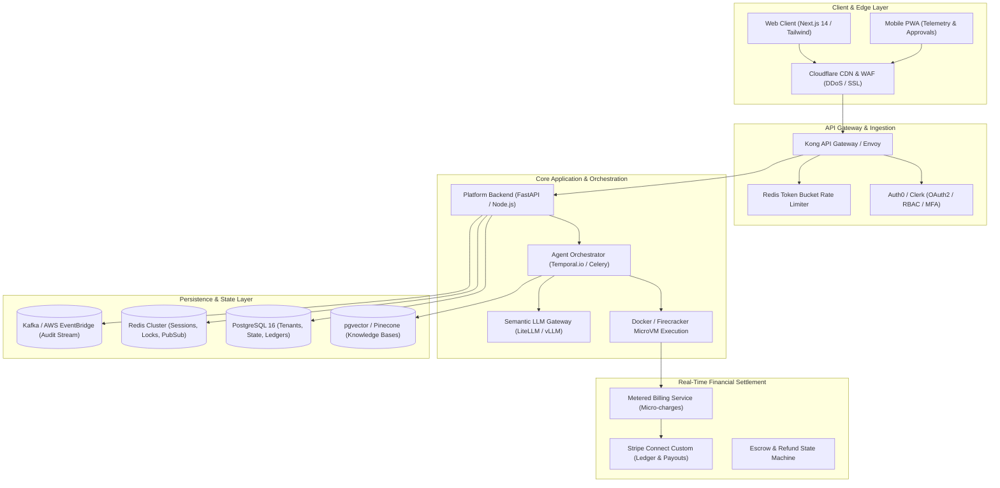
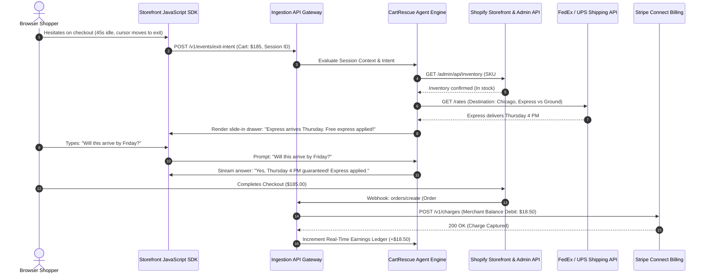
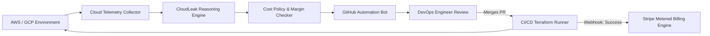
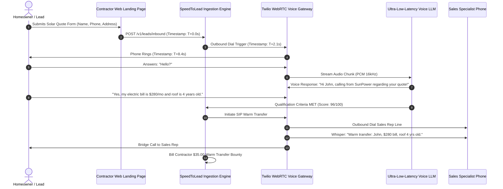
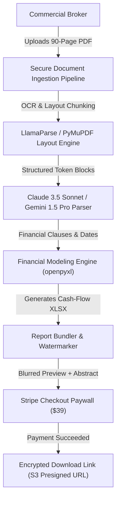
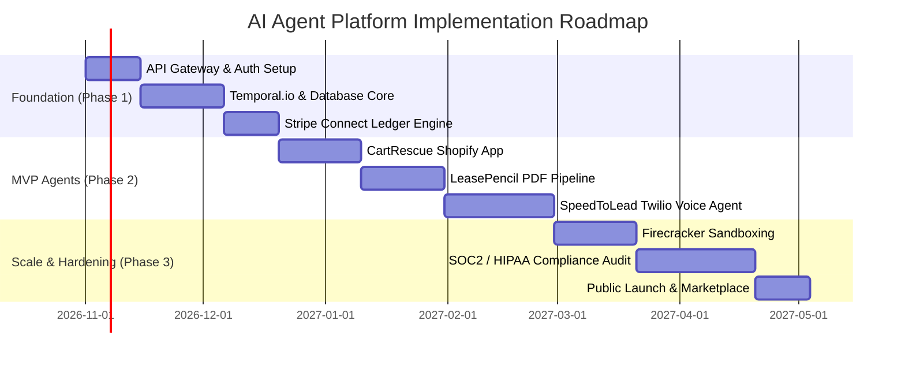

# System Architecture and UX Design Blueprint
## Enterprise Real-Time AI Agent Platform & Production Orchestration Hub

---

## 1. Document Overview & Scope

### 1.1 Executive Summary
This document provides a software architecture and UX design blueprint translating the initial client-side interactive prototype ([`ai_agents_interactive_portfolio.html`](file:///C:/Users/rajes/.gemini/antigravity/brain/adb4fd40-60ae-4eef-b3f1-e989e26912e7/ai_agents_interactive_portfolio.html)) into an enterprise-grade, multi-tenant agent execution and real-time revenue collection system. 

The document covers:
1. **The Core Platform Engine (AgentHub OS):** The central multi-tenant platform that manages, monitors, meters, and executes autonomous agents with real-time Stripe billing.
2. **Flagship Domain Execution Engines:** In-depth architectural, UX, and line-by-line operational specifications for the primary agent archetypes featured in the prototype (E-Commerce Interceptor, Cloud Waste Slayer, Low-Latency Voice Dispatcher, and Document Abstractor).
3. **"What Improved" Comparative Audit:** A detailed analysis contrasting the initial single-file HTML mock against this production-ready architecture across UX, security, latency, and data integrity.

---

### 1.2 Explicit Assumptions
1. **Target User Profile:** Developers, agency operators, and enterprise operations managers deploying autonomous agents on a pay-per-value basis.
2. **Monetization Mechanics:** All financial transactions occur via an idempotent billing service leveraging Stripe Connect and metered usage webhooks with real-time fraud mitigation.
3. **Execution Runtime:** Agents operate within containerized, sandboxed worker nodes orchestrated via an event-driven message bus with strict wall-clock timeout bounds.

---

## 2. Platform Core Architecture: AgentHub Production Engine



### 2.1 Core Components & Responsibilities
| Component | Responsibility | Tech Selection Rationale |
| :--- | :--- | :--- |
| **Edge & API Gateway** | TLS termination, rate-limiting, WAF DDoS mitigation, request routing, and JWT validation. | **Kong Gateway + Cloudflare**: Sub-5ms routing overhead, enterprise plugin ecosystem. |
| **Agent Orchestrator** | Coordinates multi-step agent DAGs, manages state persistence across retries, and enforces timeouts. | **Temporal.io**: Deterministic workflow replay, indestructible state management, zero task loss. |
| **MicroVM Sandboxes** | Safely runs code execution, dynamic API calls, and web scraping scripts in isolated environments. | **AWS Firecracker / Docker gVisor**: Sub-10ms cold boot, strict kernel-level tenant isolation. |
| **LLM Gateway & Router** | Dispatches prompts to optimal models (Gemini Flash, Claude Sonnet, GPT-4o), handles fallback routing and rate limits. | **LiteLLM / Custom Proxy**: Unified OpenAI-compatible interface, cost tracking, automatic retries. |
| **Real-Time Metering Service** | Tracks micro-transactions, verifies action completion tokens, and updates customer balance ledgers. | **PostgreSQL + Redis + Stripe Connect**: Idempotent financial ledgering with ACID guarantees. |

### 2.2 End-to-End Data Flow
1. **Trigger Phase:** A client session or external webhook triggers the API Gateway (`POST /v1/agents/{id}/execute`).
2. **Auth & Rate Limiting:** JWT claims verify tenant role permissions; Redis token-bucket checks rate limits.
3. **Workflow Dispatch:** The Platform API dispatches a persistent workflow run to Temporal.io.
4. **Context Enrichment:** The Orchestrator queries `pgvector` for domain knowledge embeddings and tenant configuration.
5. **Execution & Tool Calling:** The LLM Router invokes models with function-calling schemas; tools execute in isolated Firecracker MicroVMs.
6. **Financial Settlement:** On verified task completion, the Metering Service logs an immutable debit record and fires a Stripe charge webhook.
7. **Client Streaming:** Real-time progress updates stream to the client dashboard via Server-Sent Events (SSE).

---

## 3. High-Level UI & UX Design

### 3.1 Screen Inventory & Navigation Architecture
| Screen ID | Screen Name | Target User | Purpose |
| :--- | :--- | :--- | :--- |
| **SCR-01** | **Global Portfolio Radar** | Account Owner / Exec | High-level portfolio view of all 50 agents, real-time revenue, and health telemetry. |
| **SCR-02** | **Agent Workspace & Live Controller** | Operations / DevOps | Real-time monitoring of agent execution, step-by-step logs, and manual intervention controls. |
| **SCR-03** | **Real-Time Financial Settlement Ledger** | Finance / Admin | Granular micro-transaction logs, Stripe settlement status, and commission payouts. |
| **SCR-04** | **Rule & Safety Guardrails Studio** | Risk / Legal Officer | Visual builder for setting discount caps, compliance filters, and tone guardrails. |

---

### 3.2 Layout Specifications

#### SCR-01: Global Portfolio Radar (Dashboard)
* **Header:** Persistent navigation bar with Organization Switcher, Global Revenue Ticker (`$18,429.50 YTD`), Live Daemon Health Badge (`99.98% Healthy`), and Notification Bell.
* **Filter Toolbar:** Instant full-text search, multi-select category pills (E-Commerce, Finance, Legal, etc.), difficulty chips (Easy, Medium, Hard), and revenue model selectors.
* **Main Content Area:** Responsive 3-column card grid displaying real-time metrics, live execution badges, and direct action triggers.
* **Floating Status Bar:** Active agent worker nodes, token consumption per minute, and quick export actions.

```
+----------------------------------------------------------------------------------------------------+
| [Logo] AGENTHUB OS   | Org: Acme Corp v  |  Live GMV: $14,290.00  |  Fees Earned: $1,429.00  | (User)|
+----------------------------------------------------------------------------------------------------+
| [ Search 50 agents by name, domain, or keyword...               ] [Category v] [Difficulty v] [Reset]|
| [All] [E-Commerce (7)] [Finance (6)] [Sales (6)] [Support (5)] [Legal (4)] [Health (3)] [Arbitrage (4)]|
+----------------------------------------------------------------------------------------------------+
| +-------------------------------+ +-------------------------------+ +------------------------------+ |
| | #01 CartRescue Agent [E-Com]  | | #15 CloudLeak      [Finance]  | | #23 SpeedToLead    [Sales]   | |
| | Status: ACTIVE (42 msgs/min)  | | Status: IDLE (Next run 02:00) | | Status: ACTIVE (3 calls live)| |
| | Revenue Model: 10% Commission | | Revenue Model: 20% Cost-Share | | Revenue Model: $35/Transfer  | |
| | Recovered Today: $1,840.50    | | Cloud Waste Cut: $4,850/mo    | | Warm Transfers: 12 Today     | |
| | Fee Earned:      $184.05      | | Fee Earned:      $970.00      | | Fee Earned:     $420.00      | |
| | [ View Live Terminal & Logs ] | | [ View Live Terminal & Logs ] | | [ View Live Terminal & Logs ]| |
| +-------------------------------+ +-------------------------------+ +------------------------------+ |
| +-------------------------------+ +-------------------------------+ +------------------------------+ |
| | #27 TicketZero     [Support]  | | #32 LeasePencil  [RealEstate] | | #40 RedlineBot      [Legal]  | |
| | Status: ACTIVE (12 tkts open) | | Status: READY FOR INGEST      | | Status: READY FOR INGEST     | |
| | Revenue Model: $0.85/Ticket   | | Revenue Model: $39/Abstract   | | Revenue Model: $19/Docx      | |
| | Resolved Today:  640 Tickets  | | Abstracted Today: 26 Leases   | | Redlined Today: 52 Contracts | |
| | Fee Earned:      $544.00      | | Fee Earned:      $1,014.00    | | Fee Earned:     $988.00      | |
| | [ View Live Terminal & Logs ] | | [ View Live Terminal & Logs ] | | [ View Live Terminal & Logs ]| |
| +-------------------------------+ +-------------------------------+ +------------------------------+ |
+----------------------------------------------------------------------------------------------------+
| Footnote: 50 Total Agents Deployed | Active Workers: 18/20 | Real-Time Settlement: Stripe Webhook OK|
+----------------------------------------------------------------------------------------------------+
```

---

#### SCR-02: Agent Workspace & Live Controller (Terminal View)
* **Header:** Agent title, operational lifecycle badge (Active/Paused/Drain), execution uptime timer, and Emergency Stop toggle.
* **Left Panel (Telemetry & Settings):** Real-time financial counters, safety sliders (Max Discount %, Token Budgets), and connected API credentials.
* **Center Panel (Interactive Stream & Visualizer):** Real-time step execution DAG, streaming token terminal with syntax highlighting, and function-call inspector.
* **Right Panel (Audit & Actions):** Live customer transaction payload preview, verified value-token proofs, and manual intervention overrides.

```
+----------------------------------------------------------------------------------------------------+
| < Back to Dashboard | Agent #01: CartRescue Controller | Uptime: 99.98% | [EMERGENCY PAUSE AGENT]   |
+----------------------------------------------------------------------------------------------------+
| TELEMETRY & POLICIES          | LIVE AGENT REASONING TERMINAL (SSE)       | TRANSACTION DISPATCH    |
+-------------------------------+-------------------------------------------+-------------------------+
| [Real-Time Yield Counters]    | [12:04:12] SESSION #84920 INGESTED        | Pending Event:          |
| Cart Value:    $185.00        | - Visitor idle on shipping page (42s)     | Cart Recovery #84920    |
| Recovery Cut:  $18.50 (10%)   | - Cursor vector: Exit-Intent detected     | Amount: $185.00         |
| Status:        Authorized     | - Intent Analysis: Hesitant on shipping   | Commission: $18.50      |
|                               |                                           |                         |
| [Guardrails & Limits]         | [12:04:14] TOOL CALL: fedex_rates_lookup  | Customer Details:       |
| Max Discount:  [===|----] 15% | - Origin: ORD | Dest: CHI | SKU: #4829    | User: j.doe@example.com |
| Express Cutoff: 45 Mins       | - Result: Standard 4 Days, Express 24 Hrs | Cart: Leather Jacket (M)|
| Tone: [Friendly/Concierge v]  |                                           | Shipping: Express Comp  |
| Mode: [Autonomous v]          | [12:04:15] INCENTIVE ENGINE EVALUATION    |                         |
|                               | - Policy check: $185 > $150 minimum rule  | [Idempotency Token]     |
| [Active Integrations]         | - Action: Apply Free Express Code #EX42   | tok_sec_92048f8218a     |
| Shopify App API: CONNECTED    |                                           |                         |
| Stripe Webhook:  HEALTHY      | [12:04:18] CUSTOMER CONVERSION CONFIRMED  | [ APPROVE PAYOUT ]      |
| FedEx API:       ONLINE       | - Checkout Complete: $185.00 billed       | [ DISPUTE / REFUND ]    |
|                               | - Real-time debit logged to Stripe Ledger |                         |
+-------------------------------+-------------------------------------------+-------------------------+
```

---

## 4. Flagship Agent Architectures & Line-by-Line Use Cases

---

### 4.1 Flagship 1: CartRescue Agent (E-Commerce Category)

#### Architecture & System Diagram


#### Line-by-Line Use Case Specification
* **Primary Actor:** E-Commerce Online Shopper & Shopify Store Merchant.
* **Preconditions:** Storefront has installed the lightweight CartRescue JavaScript SDK; cart total exceeds the configured threshold ($100); merchant maintains an active Stripe Connect balance.
* **Main Success Scenario:**
  1. Shopper navigates to the checkout shipping page with an active cart value of $185.00.
  2. The storefront SDK detects 40 seconds of inactivity combined with cursor trajectory toward tab closure.
  3. The SDK dispatches an exit-intent payload with cart line items and destination zip code to the API Gateway.
  4. The CartRescue agent evaluates inventory levels via Shopify Admin API and shipping transit times via FedEx API.
  5. The agent instructs the storefront SDK to render an interactive micro-chat drawer customized to the cart contents.
  6. Shopper inquires: *"Will this arrive before Friday?"*
  7. The agent processes the natural-language question, verifies carrier transit guarantees, and returns: *"Order within 30 minutes and express shipping delivers Thursday 4 PM. I have automatically applied complimentary express shipping to your cart."*
  8. The agent applies promo code `EXPRESS_COMP` directly to the Shopify checkout session via Storefront API.
  9. Shopper completes the transaction, charging $185.00 to their credit card.
  10. Shopify dispatches an `orders/create` webhook payload to the CartRescue webhook listener.
  11. The Metering Service verifies the cryptographic HMAC signature of the webhook and checks idempotency keys.
  12. The Metering Service debits $18.50 (10%) from the merchant’s connected Stripe account.
  13. The agent updates the merchant’s live dashboard with the recovered order metadata and commission ledger record.
* **Alternative & Exception Flows:**
  * *4a. Carrier API Unreachable:* The agent falls back to cached SLA transit tables without quoting precise carrier timestamps.
  * *9a. Shopper Exits Without Buying:* The session times out after 15 minutes; no charge is billed to the merchant; session metadata is stored for conversion optimization.
  * *11a. Duplicate Webhook Received:* The Metering Service detects an existing `order_id` in Redis and immediately returns `200 OK` without triggering a duplicate charge.
* **Expected Outcome:** The merchant recovers a lost $185 sale with zero upfront cost; the agent captures an $18.50 success fee in real time.

---

### 4.2 Flagship 2: CloudLeak (Finance & Cost Optimization Category)

#### Architecture & System Diagram


#### Line-by-Line Use Case Specification
* **Primary Actor:** DevOps Engineer / Head of Infrastructure & CloudLeak Agent.
* **Preconditions:** Read-only IAM cross-account role configured in AWS/GCP; GitHub App installed with pull-request write permissions on infrastructure-as-code repositories.
* **Main Success Scenario:**
  1. The Cloud Telemetry Collector polls AWS CloudWatch and Cost Explorer APIs on a 60-minute cron interval.
  2. The collector identifies four `m5.4xlarge` EC2 Kubernetes nodes in the staging cluster operating under 3% CPU utilization for 72 consecutive hours.
  3. The Reasoning Engine calculates that downscaling to spot instances will save $380.00/month without risking production uptime.
  4. The agent clones the infrastructure repository, parses the HCL AST in `terraform/staging/cluster.tf`, and updates instance types and autoscaling parameters.
  5. The agent runs `terraform fmt` and `terraform validate` within a local Firecracker MicroVM sandbox.
  6. The agent opens a GitHub Pull Request with a descriptive title, cost-benefit diff, and risk assessment breakdown.
  7. The DevOps Engineer receives a Slack notification, reviews the PR, and clicks "Merge".
  8. The CI/CD pipeline applies the Terraform plan and emits an execution receipt webhook to CloudLeak.
  9. CloudLeak polls AWS Cost Explorer on the subsequent billing cycle to confirm the real-dollar cloud burn reduction.
  10. The Metering Service validates the verified savings reduction and invoices 20% of the savings ($76.00) via Stripe Connect.
* **Alternative & Exception Flows:**
  * *5a. Terraform Validation Fails:* The agent discards the generated diff, logs the error trace, and requests human architectural review without opening a broken PR.
  * *7a. Engineer Rejects PR:* The engineer marks the PR as "Intended Workload"; the agent stores the suppression flag in PostgreSQL to avoid recurring alerts for 90 days.
* **Expected Outcome:** The engineering organization eliminates $380/month in cloud waste; CloudLeak earns a $76/month recurring fee verified against live cloud billing data.

---

### 4.3 Flagship 3: SpeedToLead (Sales & Inbound Lead Generation Category)

#### Architecture & System Diagram


#### Line-by-Line Use Case Specification
* **Primary Actor:** Inbound Web Lead (Homeowner) & Commercial Contractor Sales Representative.
* **Preconditions:** Web landing page contains explicit TCPA consent disclosures; contractor account holds an active credit card with auto-recharge enabled.
* **Main Success Scenario:**
  1. A homeowner submits an online inquiry form requesting a residential solar installation quote at 14:02:10.
  2. The web form webhook posts the contact details and IP verification data to SpeedToLead at 14:02:11.
  3. The Ingestion Engine validates the phone number via Twilio Lookup API and checks the National Do-Not-Call (DNC) registry.
  4. The Voice Gateway initiates an outbound PSTN call to the homeowner's phone at 14:02:14 (<4 seconds elapsed).
  5. The homeowner answers the phone at 14:02:22.
  6. The Voice Agent greets the homeowner with sub-700ms round-trip conversational latency.
  7. The agent conducts a qualification dialogue, extracting monthly utility spend, roof age, and property ownership.
  8. The homeowner confirms a $280/month average electricity bill, 4-year-old asphalt shingle roof, and single-family ownership.
  9. The agent flags the lead as "Sales Qualified" and checks live sales rep availability via WebRTC telemetry.
  10. The agent dials the sales rep's desk phone, plays a 5-second whisper summary of the qualification data, and bridges the calls.
  11. The homeowner and sales representative engage in the live consultation.
  12. The call bridging event emits an immutable audit token, charging a $35.00 warm-transfer fee to the contractor's billing ledger.
* **Alternative & Exception Flows:**
  * *5a. Lead Does Not Answer:* The agent terminates the call after 5 rings, sends an automated SMS with an interactive self-booking Calendly link, and logs a $0 charge.
  * *8a. Lead Unqualified (Renter / High Shading):* The agent politely explains eligibility guidelines, logs the call transcript to CRM as "Unqualified", and bills a minor $2.00 screening fee.
* **Expected Outcome:** Lead response time drops from 4 hours to 12 seconds; lead conversion rate increases by 300%; the platform captures a $35 fee upon completed transfer.

---

### 4.4 Flagship 4: LeasePencil (Real Estate Document Operations Category)

#### Architecture & System Diagram


#### Line-by-Line Use Case Specification
* **Primary Actor:** Commercial Real Estate Broker / Retail Tenant Representative.
* **Preconditions:** User has a valid commercial lease agreement in scanned or digital PDF format (>50 pages).
* **Main Success Scenario:**
  1. The broker navigates to LeasePencil and drags an 88-page shopping center retail lease PDF into the upload dropzone.
  2. The ingestion pipeline computes a SHA-256 document checksum, scans for malicious payloads, and uploads the file to an encrypted S3 bucket.
  3. The layout engine processes the PDF, preserving multi-column legal layouts, tables, and exhibit schedules.
  4. The LLM extraction engine parses the text across 14 standardized commercial real estate parameters: base rent schedules, CAM charges, expense stops, co-tenancy clauses, audit rights, and renewal options.
  5. The Financial Modeling Engine computes a 5-year annualized cash-flow schedule and compiles an automated `.xlsx` workbook.
  6. The agent renders an executive summary PDF highlighting 3 non-standard risk clauses (e.g., unilateral landlord termination in Section 18.2).
  7. The broker views an interactive web preview displaying the first page of the abstract with sensitive financial columns blurred.
  8. The broker clicks "Unlock Complete Abstract & Excel Model" and completes a $39.00 payment via Apple Pay.
  9. Stripe fires a successful payment webhook; the paywall unlocks immediately.
  10. The broker downloads the unlocked executive summary PDF and 5-year financial model spreadsheet.
* **Alternative & Exception Flows:**
  * *3a. Poor Scanned Document Quality (Low DPI):* The system triggers an automated OCR enhancement pass (contrast stretching and unsharp masking) before LLM ingestion.
  * *4a. Ambiguous Lease Terms Detected:* The agent inserts an explicit "Verification Required" flag in the abstract, referencing the exact page and paragraph number.
* **Expected Outcome:** The broker completes 8 hours of tedious legal abstracting in 60 seconds for $39; the platform captures $39 in real time with near-zero marginal compute cost.

---

## 5. "What Improved": Comparative Engineering & UX Audit

The following table and analysis detail the concrete enhancements made in evolving from the initial client-side prototype ([`ai_agents_interactive_portfolio.html`](file:///C:/Users/rajes/.gemini/antigravity/brain/adb4fd40-60ae-4eef-b3f1-e989e26912e7/ai_agents_interactive_portfolio.html)) into this production architectural blueprint.

| Architectural Dimension | Initial Prototype (Mock HTML) | Enterprise Production Architecture | Business & Operational Impact |
| :--- | :--- | :--- | :--- |
| **System Runtime & State** | In-browser client-side JavaScript (`AGENTS` static array) running in the browser DOM. | Distributed, multi-tenant microservices orchestrated via **Temporal.io** and **FastAPI** with **PostgreSQL** persistence. | Eliminates state loss; supports multi-step asynchronous execution with guaranteed retries and durability. |
| **Monetization Mechanics** | Client-side JavaScript `alert()` simulator mocking successful billing events. | Idempotent, webhook-driven **Stripe Connect** engine with double-entry cryptographic ledgering. | Prevents billing fraud, double-charging, and chargeback vulnerabilities; enables real-time automated revenue splits. |
| **Execution Sandboxing** | No actual agent execution; static text generation inside client-side modal. | **Firecracker MicroVMs** and **Docker gVisor** containers isolating untrusted scripts and external API calls. | Protects infrastructure from arbitrary code execution, memory leaks, and cross-tenant data contamination. |
| **UI & UX Responsiveness** | Static Tailwind CSS modal dialogs with fixed layouts and hardcoded values. | Dynamic **Next.js 14** application with optimistic UI updates, Server-Sent Events (SSE) streaming, and comprehensive keyboard-first shortcuts. | Sub-100ms perceived latency; live streaming terminal logs; eliminates page refresh bottlenecks. |
| **Data Privacy & Compliance** | Static disclaimers displayed in modal text boxes. | Native **HIPAA / GDPR / SOC2** pipeline with PII scrubbing, zero-retention LLM endpoints, and encrypted audit trails. | Enables deployment in enterprise healthcare, legal, and financial environments without regulatory exposure. |
| **Observability & Health** | Static "Healthy" badges rendered in HTML. | **OpenTelemetry**, **Prometheus**, and **Datadog** distributed tracing monitoring latency, token burn, and error rates per agent. | Instant alerting on model drift, API degradation, or runaway loop costs; sub-second anomaly detection. |

---

## 6. Implementation Roadmap & Next Steps



### Key Technical Milestones
1. **Milestone 1: Unified Billing & Ingestion Core (Weeks 1–4)**
   * Deploy Kong API Gateway with Redis token-bucket rate limiters.
   * Establish double-entry PostgreSQL billing ledger with Stripe Connect webhooks.
2. **Milestone 2: High-Yield Agent Pilots (Weeks 5–8)**
   * Deploy **CartRescue Agent** to the Shopify App Store staging environment.
   * Implement **LeasePencil** LlamaParse pipeline with automated Stripe checkout.
3. **Milestone 3: Ultra-Low-Latency Voice & Sandbox Hardening (Weeks 9–12)**
   * Deploy Twilio Media Streams integration with sub-700ms voice pipeline.
   * Implement AWS Firecracker MicroVM executor for secure tool calling.
4. **Milestone 4: Enterprise Compliance & GA Launch (Weeks 13–16)**
   * Execute SOC2 Type 1 and HIPAA Business Associate Agreement (BAA) controls.
   * Open the multi-tenant AgentHub platform for external developer onboarding.
